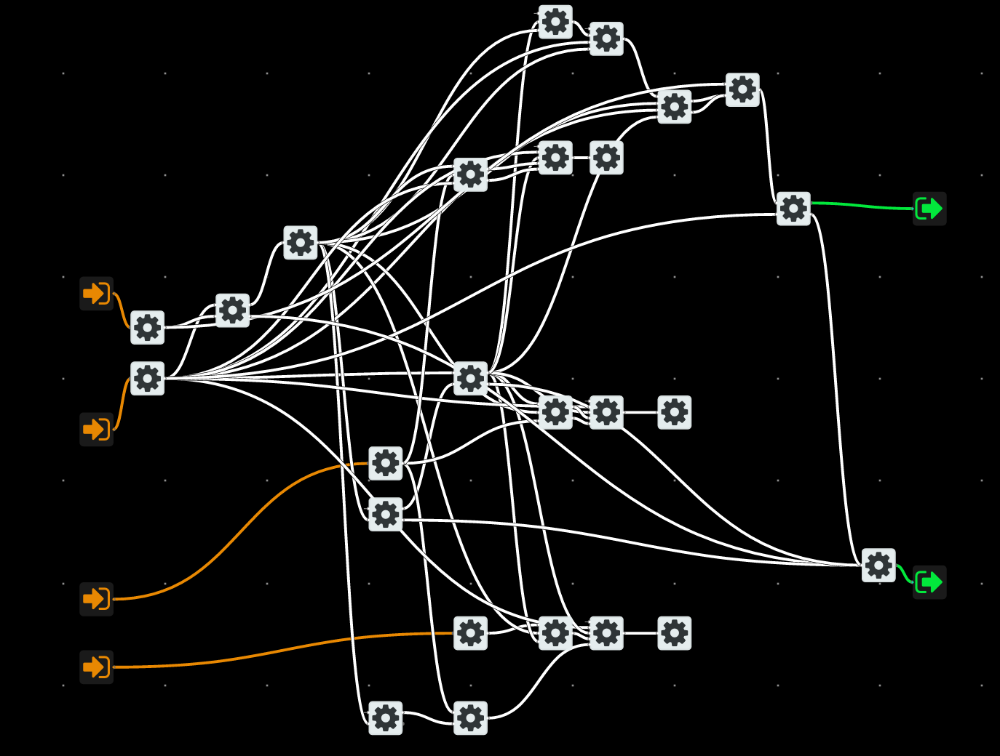
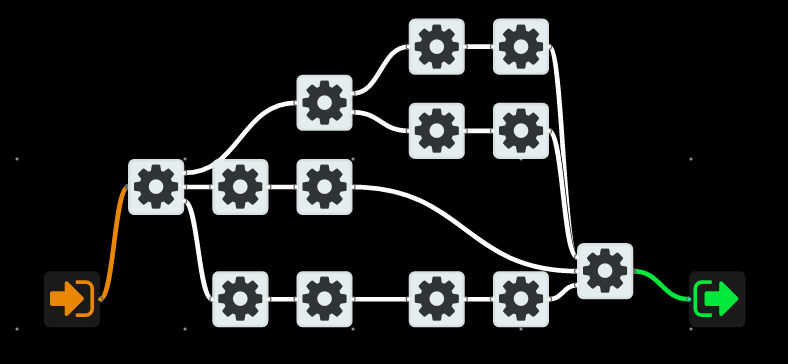

<!-- Brought in from the noflo-assembly GitHub wiki (2026-10), updated for NoFlo 2.x / @noflo/assembly -->

> Mass production systems for items made of numerous parts are usually organized into [assembly lines](https://en.wikipedia.org/wiki/Assembly_line). The assemblies pass by on a conveyor, or if they are heavy, hung from an overhead crane or monorail.
>
> In a factory for a complex product, rather than one assembly line, there may be many auxiliary assembly lines feeding sub-assemblies (i.e. car engines or seats) to a backbone "main" assembly line. A diagram of a typical mass-production factory looks more like the skeleton of a fish than a single line.

_From [Wikipedia](https://en.wikipedia.org/wiki/Mass_production#Use_of_assembly_lines)_

## Rationale

This design pattern is a result of developing real world NoFlo backend systems for 3 years and facing the following problems:

* Component definitions are verbose and slow down creation of new components
* Wiring up and maintaining a graph where components have many input and output ports is tedious and error-prone.
* Testing parts of graphs during development takes lots of effort
* Finding a point of failure is hard when debugging, even with [Flowtrace](https://github.com/flowbased/flowtrace) at hand
* Conditionals/branching in graphs duplicates the code and errors
* Component granularity: in real apps there are often microcomponents like `objects/GetObjectKey`, and macrocomponents like `foo/UserRegistrationController`, and the mixture of micro and macro which is frankly not a good FBP design
* Inconsistency between port types within application: some components use objects as a whole, some expect just atomic properties of the same objects
* Kitchen-sink-style error handling is both laborious and unsafe
* Errors in concurrent branches lead to data races and crashes if not handled properly

Some best practices on how to design components, graphs and certain aspects of the application arouse to solve these problems. Put together with a library to support those patterns, it makes NoFlo Assembly Line.

Main inspiration comes from factory assembly lines and "String of Pearls" design pattern by [J Paul Morrison](http://www.jpaulmorrison.com/fbp/index.shtml), or plenty of other similar pipeline approaches, but with attention paid to concurrent processing and current state of things in NoFlo.

This pattern takes the visual part to a high level of abstraction and is not meant to be used in dataflow applications that need fine-grained components, atomic data and the closest to bare metal possible.

Primary application domain of this pattern is data processing backends and APIs, and other systems that deal with requests or jobs.

## Refactoring example

To give you an idea of the impact that refactoring a part of NoFlo backend with Assembly Line can have, here are a couple of graph screenshots.

**From**

**To**

## Mental image

With a solid approach to application design, you can view the whole application as a mental image and you can refer to that image every time you need to think about application architecture or behavior.

Consider whole application as an industrial factory producing complex objects. Parts of the application that implement specific features are assembly lines. Multiple assembly lines are connected together in a shape similar to a skeleton of fish.

Assembly lines consist of worker components and incoming objects are passed from one worker to another, producing a complete or intermediate result at the end of the line.

Parts of the assembly line are black boxed as subgraphs, meaning that some of the workers are assembly lines themselves. Requests travel along the assembly line as composite assembly objects, being added more data or modified the existing. 

Assembly lines can be split into parallel lines and converged back to make the request processing time shorter, but splitting and merging is always explicit in the graph and even when the request is split into multiple packets, it still references the original object to be merged or rejected correctly when needed.

### Glossary

* *Assembly line* - a graph that passes assembly messages along
* *Assembly message* or *product* or *aggregate* - an IP object that contains all the data belonging to a request, including the request itself, data required for further processing and intermediate results
* *Assembly workers* - components that follow the ports and message passing convention below and can be combined into assembly lines

No more theory needed, now you can proceed to the library examples or conventions in this Wiki.